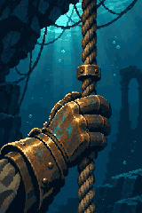
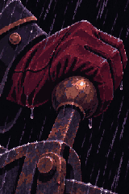
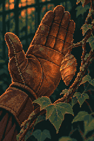
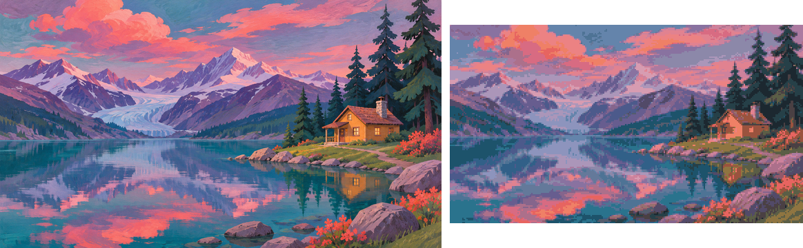
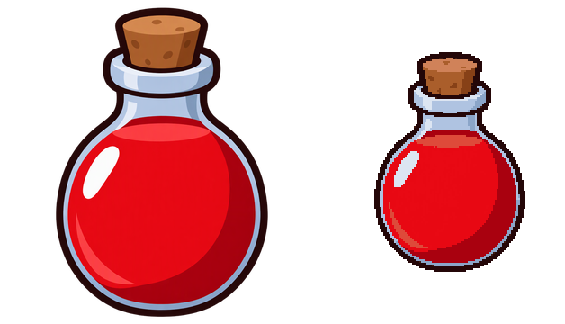
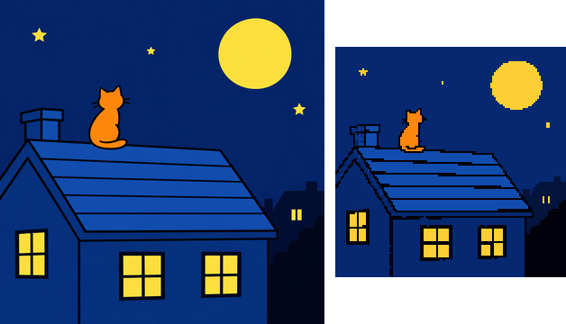
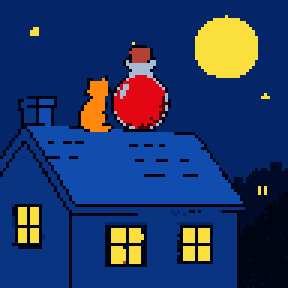
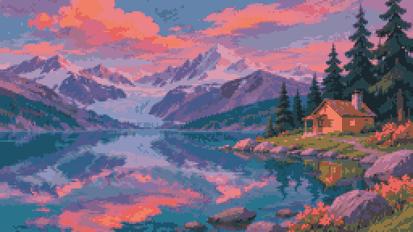

<div align="center">
  <picture>
    <source media="(prefers-color-scheme: dark)" srcset=".github/logo-dark.svg">
    <source media="(prefers-color-scheme: light)" srcset=".github/logo-light.svg">
    
  </picture>
  <h1>pixel-cat</h1>
  <p>Turn an image, GIF, video or sprite sheet into pixel art.<br>Agents drive it with shell commands and JSON. Nothing leaves your machine.</p>
</div>

<div align="center">

[![License: MIT][license-shield]][license-url]
[![Python 3.11+][python-shield]][python-url]
[![Version 0.2.0][version-shield]][version-url]
[![Exports PNG, GIF, MP4, WebM][exports-shield]][exports-url]
[![npx skills add pyros-projects/pixel-cat][skill-shield]][skill-url]
[![Runs offline][offline-shield]][offline-url]

</div>

<div align="center">
  <a href="#install-as-an-agent-skill">Install as a skill</a> &middot;
  <a href="#start">Quick Start</a> &middot;
  <a href="#use-from-an-agent">Use from an agent</a> &middot;
  <a href="#make-a-film">Make a film</a> &middot;
  <a href="docs/recipes.md">Recipes</a> &middot;
  <a href="https://github.com/pyros-projects/pixel-cat/issues/new">Report Bug</a>
</div>

<br>

---

## Three 15-second films

<div align="center">

| Tide Bell | Platform Zero | Emberwing |
| :---: | :---: | :---: |
| [](media/tide-bell.mp4) | [](media/platform-zero.mp4) | [](media/emberwing.mp4) |
| [Watch with sound](media/tide-bell.mp4) · [Scene file](examples/films/tide-bell/story.json) | [Watch with sound](media/platform-zero.mp4) · [Scene file](examples/films/platform-zero/story.json) | [Watch with sound](media/emberwing.mp4) · [Scene file](examples/films/emberwing/story.json) |

</div>

Play the MP4s to hear the diver's bell, the lever hitting its stop and the chrysalis cracking. ImageGen supplied the paintings. The film scripts convert them with pixel-cat, move the props and sprites on a 240 × 360 grid, and synthesize the stereo sound. The camera moves between cells, so zooms and pans stay sharp without shimmering. FFmpeg encodes the 720 × 1080 MP4s. [Artwork prompts](examples/films/ART.md)

## A 30-second game intro

<div align="center">

[](media/roomwright-intro.mp4)

[Watch with sound](media/roomwright-intro.mp4) · [Scene file](examples/films/roomwright/story.json) · [Play Roomwright](https://play-roomwright.netlify.app) · [Roomwright's source](https://github.com/pyros-projects/roomwright)

</div>

[Roomwright](https://github.com/pyros-projects/roomwright) is a browser game, and this film plays before its title screen. The same film scripts made it, with eight landscape shots on a 400 × 225 grid. An image model painted each shot from a model sheet of the game's own sprites, which kept the hero on model. pixel-cat converted the paintings to 64-color plates, and the key and the glint from the model sheet to sprites. The scene file adds camera moves, a door that jumps with each knock and rooms that pop onto the map one by one. The soundtrack plays the game's title theme, and the cuts fall on its beats. The game drew the logo and the captions in its own font. The captions go on after rendering, so a camera move never touches them. [How it was built](https://github.com/pyros-projects/roomwright/tree/main/intro)

## Install as an agent skill

```sh
npx skills add pyros-projects/pixel-cat -g -s pixel-cat
```

[skills](https://skills.sh) installs the [`pixel-cat` skill](skills/pixel-cat/SKILL.md) for Claude Code, Codex, Cursor and the other agents it supports. It needs Node.js 22.20 or newer. Leave out `-g` to install the skill for the current project only. Then ask your agent from any folder:

- “Turn ~/Pictures/cat.jpg into a 64-color pixel sprite.”
- “Make this screen recording a pixel-art GIF with 16 colors.”
- “Make a looping pixel GIF of this landscape with drifting clouds and moving water.”
- “Make a 15-second pixel-art film about a lighthouse keeper winding a clockwork sun.”

On first use the skill clones this repository into `~/.local/share/pixel-cat/app` (on Windows, `%LOCALAPPDATA%\pixel-cat\app`), creates its Python environment and remembers the folder. Your images and films stay in your own folders. The install needs git and uv. FFmpeg is needed for video input, MP4, WebM and films. Say “update pixel-cat” to pull a new version.

## Start

To work in a clone yourself, use Python 3.11 or newer and uv.

```sh
git clone https://github.com/pyros-projects/pixel-cat && cd pixel-cat
uv sync --locked
uv run pixel-cat convert examples/images/lake.png -o output/lake.png
uv run pixel-cat convert examples/images/bob.gif -o output/bob.gif --scale 3
```

## Use from an agent

```sh
uv run pixel-cat catalog
uv run pixel-cat convert examples/images/potion.png --mode grid --grid 64 --sampling ink --colors 12 --scale 1 -o output/sprite.png
uv run pixel-cat convert examples/images/lake.png --mode faithful --width 480 --pixel 4 --palette dusk16 -o output/dusk.png
uv run pixel-cat convert examples/images/spin-sheet.png --sheet 4x2 --delay 80 --mode grid --grid 48 -o output/spin.gif
uv run pixel-cat run examples/recipes/bob.json
```

A successful command prints one JSON object with the grid size, the number of colors, the frame timings and the files it wrote. In recommended mode it also reports the settings it chose, so an agent can repeat or adjust them. Errors go to stderr as JSON with a nonzero exit. A recipe is the same job as a JSON file; it can write several outputs at once and also works over stdin with `pixel-cat run -`. [Recipe reference](docs/recipes.md)

## Modes

<div align="center">



| | | |
| :---: | :---: | :---: |
|  |  |  |
| `pixel-cat convert potion.png -o sprite.png` | `pixel-cat convert rooftop.png -o rooftop.png` | `pixel-cat convert bob.gif -o bob.gif --mode grid --grid 96 --sampling crisp --colors 16` |

</div>

The stills above came out of one command each, with no settings chosen by hand. pixel-cat is plain Python with numpy and Pillow, and it makes no network calls. A conversion takes a fraction of a second.

| Mode | What it does |
| --- | --- |
| `recommended` | Reads the picture and chooses the grid, the sampler, the number of colors and the cleanup. `--contrast` reduces the picture to its few big shapes. |
| `grid` | You set the longest side in cells, or `native` to keep the size. Four samplers decide what a cell shows: the pixel under its center (`exact`), the average of its area (`area`), its dominant color (`crisp`), or its dominant color with thin dark outlines kept (`ink`). |
| `faithful` | Samples on a regular grid of `--pixel`-sized cells and maps to the source colors, a named palette or your own colors. |
| `artist` | Smooths areas of similar brightness, lifts the saturation and snaps to a palette. `--strength` sets how far regions merge. |

Reducing colors follows the crowd, so a small red scarf in a blue picture can turn blue. pixel-cat checks for that: a small area with a color of its own keeps a palette entry. `--symmetry left` or `right` mirrors one half onto the other. `--palette` takes `source`, one of the 18 names from `pixel-cat catalog`, or a comma-separated list of `#RRGGBB` colors.

Animations convert frame by frame and share one palette. Still areas would flicker, because each frame rounds a little differently. A cell that barely changes over the whole loop is therefore held at one color (`--stability`, 0 switches it off), and real motion is left alone. `--frames` thins an animation out, `--speed` changes its pace, `--frame` exports a single frame as PNG.

PNG and video outputs are enlarged to a size that is easy to look at. Pass `--scale 1` for one file pixel per cell.

## Sprites

<div align="center">


</div>

```sh
uv run pixel-cat convert icon.png -o sprite.png --mode grid --grid 64 --sampling ink --colors 12 --cutout --trim --outline "#101018"
```

`--cutout` makes the background transparent, `--trim` crops to the drawing and `--outline` draws a rim around it. A recipe has more finishing steps under `edits`: pad, flip, shift, replace a color, and clean specks. [Finishing steps](docs/recipes.md#edits)

## Loops from a still

<div align="center">



</div>

A still picture can become a seamless loop. Name the regions and what moves in them: `clouds` drift, `water` ripples, `twinkle` makes small lights blink, `sway` moves leaves and grass, `rise` lifts smoke. Every effect only moves cells that are already there, so the palette stays, and the last frame leads back into the first.

```sh
uv run pixel-cat convert examples/images/lake.png -o output/lake.gif --loop clouds,water
uv run pixel-cat run examples/recipes/lake-loop.json
```

The first command guesses the sky and the water. The guess is rough, and here it takes the bright mountains for sky. The recipe draws both areas as polygons instead, which is what an agent does after one look at the picture. [Loop settings](docs/recipes.md#loop)

## Make a film

Give an agent in this checkout a subject and name the skill. Try “Use `pixel-cat-film` to make a 15-second portrait film about a lighthouse keeper winding a clockwork sun. Give the winding key a sound I can recognize in the dark.” The skill shows how to plan four shots, move a subject between keyframes, review every moving part on enlarged sheets and export a README preview. [Agent skill](.agents/skills/pixel-cat-film/SKILL.md)

With the [installed skill](#install-as-an-agent-skill), ask from any folder. The agent follows the same film skill in its pixel-cat checkout and writes the film to your folder.

To render *Tide Bell* from the included PNGs and scene file, run this from the checkout with FFmpeg on your PATH.

```sh
uv run python .agents/skills/pixel-cat-film/scripts/render.py \
  examples/films/tide-bell/story.json output/tide-bell.mp4
```

## Verify

```sh
uv run python -m unittest discover -s tests -v
```

The tests build their own inputs and check what a conversion promises: the grid size, the color limit, palette membership, kept outlines, restored pixel grids, mirrored halves, steady still areas in a loop, and the frame counts and timings of GIF, sprite-sheet and video jobs, loops that close without a jump, and the film camera.

## License

[MIT](LICENSE)

[license-shield]: https://img.shields.io/badge/license-MIT-2f7d5b?style=flat-square
[license-url]: LICENSE
[python-shield]: https://img.shields.io/badge/python-3.11%2B-3776ab?style=flat-square&logo=python&logoColor=white
[python-url]: pyproject.toml
[version-shield]: https://img.shields.io/badge/version-0.2.0-6b5fb5?style=flat-square
[version-url]: pyproject.toml
[exports-shield]: https://img.shields.io/badge/exports-PNG%20%C2%B7%20GIF%20%C2%B7%20MP4%20%C2%B7%20WebM-c9682c?style=flat-square
[exports-url]: docs/recipes.md
[skill-shield]: https://img.shields.io/badge/npx%20skills%20add-pyros--projects%2Fpixel--cat-111111?style=flat-square
[skill-url]: #install-as-an-agent-skill
[offline-shield]: https://img.shields.io/badge/runs-offline-4a8f9c?style=flat-square
[offline-url]: #start
