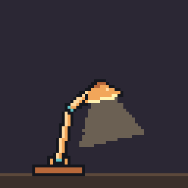

# Studio

The studio is a page on your own machine for drawing and animating a project, alone or together with an agent.

```sh
uv run pixel-cat studio sprite.pixelcat --size 32x32 --open     # creates the project if it is not there
uv run pixel-cat studio sprite.pixelcat --agent                  # from an agent's session: the chat is wired to it
```

The command prints the address (`http://127.0.0.1:4178` unless you pass `--port`) and keeps running. The server listens on this machine only. Every change is saved to the project file at once.

## The page

- **Canvas** in the middle. Scroll to zoom, hold Space and drag to pan, `0` fits the picture to the window.
- **Tools** on the left: pencil `B`, eraser `E`, fill `G`, colour picker `I` (or hold Alt), line `L`, rectangle `R` (Shift fills it), select a box `M`, lasso `Q`, polygon `W`, paint a selection `A`, protect brush `S`, melt brush `N`, edge `O`, swap brush `C`, move `V`, pose `J`, pan `H`. Below them the brush size, 1 to 64 cells (`[` and `]`), mirror `X`, and fit.
- **Melt, edge and swap:** the melt brush makes small flecks under the stroke join the shape around them. The edge tool gives the area you click a rim in the current colour, one cell wide, on its inside. The swap brush turns the colour you start on into the current colour and leaves every other colour alone.
- **Timeline** at the bottom: one column per frame, one row per layer, each cel as a small picture. A click picks the frame and the layer at once. Space plays, Left and Right step through the frames (Home and End go to the first and last), Up and Down through the layers, and the slider above the timeline runs through them all.
- **Onion skin:** `faint` lets the neighbouring frames shine through. `changes` marks every cell that differs from the frame before in red and from the frame after in cyan.
- **Several frames at once:** Shift+click a frame number to select a range. "copy" duplicates it, the arrows move it, × removes it, "selected" gives it the duration in the field, and hold and clean up can be kept to it. Drag a frame number onto another to move the frame, or the range it belongs to. "extend" adds frames that repeat the last one.
- **Colour, layers and chat** on the right. Layers can be hidden, locked, renamed (double-click), faded, reordered and merged. The palette comes from the art with one click; "edit" opens it colour by colour and takes a pasted list of `#RRGGBB` values.
- **Selections:** a box, a lasso drawn around an area, a polygon (click the corners, Enter closes, Backspace takes the last corner back), or painted with the brush (each stroke adds, Alt takes away). While something is selected, drawing stays inside it. Move with the move tool or the arrow keys (Shift: ten cells), Enter sets the moved piece down (it arrives exactly as it was, cells one can see through included: the studio moves the cells the project holds), Delete clears, Ctrl+C and Ctrl+V copy and paste (the copy also goes to the system clipboard as a PNG, and a picture copied elsewhere comes in through the import dialog), Ctrl+A selects everything, Ctrl+D or Escape lets go.
- **Draw on all:** with this ticked, a stroke also changes the other frames, or the selected range of them, wherever they showed the same as this frame did before the stroke. A part that moves through is left alone.
- **Ready-made palettes:** the list next to the palette holds the built-in ones, from 4 colours to 64. Taking one changes the palette only; lock it and the art takes its colours.
- **Locked palette:** "lock" next to the palette. From then on whatever is drawn, filled or brought in takes its nearest palette colour.
- **Hold:** a spot that flickers next to motion you want to keep. Select it, go to the frame where it looks right, press "hold" and choose "The selection stands still". The studio first shows the result with every changed cell marked, in every frame you step through; nothing happens until you press Apply. "Only the selection moves" is the other way round: everything else is taken from the frame you are on.
- **Check:** looks through all frames for flicker, stray fragments, holes and colours outside the palette, marks them on the canvas and lists the areas where they gather. "select" turns an area into the selection, ready for "hold" or a fix by hand. The list updates after every change.
- **Clean up:** thin lines to one cell and close breaks in them, remove halos beside lines, loose bits at the edge, or specks, take single bumps and dents off the silhouette or off lines, colour the edge of the drawing or draw an outline around it; on this frame, the selected frames or all, and on every colour or only the current one. Over several frames, a cell that stood still before stands still after. With a selection, the step is kept to it, or the selection is protected and everything else is cleaned. Cells painted with the protect brush stay as they are in either case (see below). "Show what it would do" puts the result on the canvas with every changed cell marked; "show before" flips back. Nothing changes until you press Apply.
- **Protect brush:** paint the cells that must not change: a face, an eye, a highlight. They show hatched. Clean up and the melt brush leave them alone, and they stay protected while you select other areas to work on. Alt takes cells away again, "clear" in the clean up panel sets all of them free.
- **Loop:** brings the frame you are on to life. Add what should move (clouds, water, swaying leaves, twinkling lights, smoke, fireflies, falling leaves, birds), then paint its area on the picture: the pencil adds cells, the eraser takes them away, the fill tool takes a whole area of similar colour. An area you do not paint is guessed. "Make the loop" puts the loop in place of the frames; undo brings them back.
- **Import:** drop a picture, a GIF or a video on the canvas. It is converted first: to fit the canvas, the way pixel-cat recommends, or not at all. It lands on a new layer, after the last frame, or in place of the project, and it can take this project's palette. Cells come in solid or empty; tick "keep soft edges" and shadows, glows and smoke stay partly see-through. A `.pixelcat` file comes in as it is: after the last frame with its layers, or in place of this project.
- **Export:** PNG of the frame, GIF, MP4, WebM, or the project file.
- **Undo** (Ctrl+Z) and Redo cover everything, also what the agent did. The top bar names the last change and who made it.

## Joints

A layer can turn around a pivot, and it can hang on another layer: a hand on a forearm, a forearm on an upper arm, a tail on a body. You draw each part once, at rest, and pose it on a few frames. The frames between follow from those.



`examples/projects/lamp.pixelcat` is this lamp: four drawings, three joints in a chain, a light that hangs on the shade, and two poses.

1. Put each part on a layer of its own. From a flat drawing: select a piece (box, lasso, polygon or the brush) and press "part" above the layers. Its cells move to a new layer with a joint, on every frame, and the next click on the picture says where it turns. "part" asks what becomes of the place the piece leaves. For a figure on empty ground it stays empty. For a piece of a flat scene, choose to have it filled: what lies around the piece is painted into its place, in the colours that are common there, so nothing opens up when the part moves. A ground that repeats itself is carried on: bricks, tiles laid from one piece, any regular pattern come back with their lines where they belong, because whole patches are copied from places that look the same. On calm ground, a wall, a sky, a dark room, the filling takes the colours that are common there. A hand-painted ground has no second place that looks the same: there painted lines break off at the filling. Redraw them, or put a picture of the ground on a layer below.
2. Pick the pose tool (`J`), pick the part's layer and click where it turns: the elbow, the hip, the hinge. That is its pivot. The drawing of the frame you are on is copied to every frame that has none.
3. Under "Hangs on", choose the part that carries it. Hang the parts on each other before you pose them.
4. Go to a frame and drag on the picture to turn the part; Shift turns in steps of 15°, Alt+drag moves it by whole cells. Each change sets a key on that frame, marked by a small diamond in the timeline. Whatever hangs on the part comes along.

Between two keys the part moves smoothly, evenly, not at all until it jumps, back first and then off, or past the mark and back. With "the motion closes into a loop" the frames after the last key lead into the first one. "Lags behind its parent" lets a part trail the turning of what carries it, the way a hand or a tail does. "Sways on its own" swings it to and fro, a whole number of times per loop. "Cover the joint" puts a disc in the current colour at the pivot, on a new layer below the part, so that no gap opens when the part turns.

While you draw on a jointed layer it shows at rest, because that is the drawing you are changing; the pose tool shows it in motion again. Turning is done cell by cell: a cell is filled when at least half of it is covered and takes the colour that covers most of it, so outlines one cell wide stay whole. Quarter turns come out exactly, and a part that moves without turning goes to the nearest whole cell as it is drawn, so a fine pattern stays intact. "Bake" turns the motion into plain frames that you can touch up by hand; the joint goes, and so do the joints of everything that hung on it.

## Working with an agent

With `--agent`, what you write in the chat goes to the agent that started the studio. It sees what you have open, the frame, the layer, your selection and your colour, and it can look at the picture, change the project and answer. Its changes appear as they happen, and a line in the chat offers to take them back in one go.

The agent's side is four commands that talk to the running studio:

| Command | What it does |
| --- | --- |
| `pixel-cat wait` | blocks until you write, then prints the message and what you have open, and exits |
| `pixel-cat look -o frame.png` | prints the project's shape and what you have open; `-o` saves the frame you are on, enlarged (`--frame`, `--layer`, `--scale`) |
| `pixel-cat op '{"op": ...}'` | changes the project with one operation |
| `pixel-cat say "text"` | answers in the chat (`-` reads the text from stdin) |
| `pixel-cat undo` | takes back the last change |

A message arrives as one line:

```
YOU [sprite.pixelcat, frame 2, layer 1 "Ink", selection x 4 y 6, 12 by 8, colour #f2a65a]: make the outline darker here
```

The loop for an agent: start the studio in the background, give the person the address, run `wait` in the background, and end the turn. When `wait` exits, read its output, `look`, change, `say`, and start `wait` again before ending the turn. While `wait` runs, the page shows the agent as listening.

## Operations

Frames and layers are counted from 0; layer 0 is the bottom one. An operation that cannot be carried out changes nothing and says why.

| Operation | Settings |
| --- | --- |
| `draw` | `layer`, `frame` or `frames` (`"all"` or a list), `color` (`"#rrggbb"`, or `null` to erase), and any of `points` `[[x, y], ...]`, `line` `[x0, y0, x1, y1]`, `rect` `[x, y, width, height]` (with `outline: true` only its border), `fill` `[x, y]` |
| `clear` | `layer`, `frame` |
| `add-layer` | `name`, `at` |
| `remove-layer`, `merge-down` | `layer` |
| `move-layer` | `layer`, `to` |
| `set-layer` | `layer`, and any of `name`, `visible`, `locked`, `opacity` |
| `add-frame` | `at`; `copy` duplicates a frame, `count` times, or several frames given as a list |
| `remove-frame` | `frame`, or `frames` (a list) |
| `move-frame` | `frame` or `frames` (a list: they end up in a row), `to` |
| `set-frame` | `frame` (a number or `"all"`) or `frames` (a list), `duration` in milliseconds |
| `palette` | `colors` or `name` (a built-in palette), and `lock` (`true` or `false`): with a locked palette every colour that is drawn moves to its nearest palette colour |
| `palette-from-art` | |
| `edits` | `layer`, `frames` (`"all"` or a list), `steps`: the [finishing steps](recipes.md#edits) that keep the size |
| `move` | `layer`, `frame` or `frames`, `x`, `y` (cells to the right and down), and an area (`rect`, `points` or `cells`; without one, the whole cel): what is drawn there is set down that far away, exactly as it was. A cell one can see through that lands on art is mixed with it, the way layers are; what leaves the picture is gone. |
| `hold` | `layer`, `from`, `frames`, and `rect`, `points` or `cells`: an area of one frame, copied into the others, so that it stands still. With `outside`, everything but the area is copied: only the area keeps moving. |
| `joint` | `layer`, and any of `pivot` (`[x, y]` in cells; the centre of cell 8, 16 is `[8.5, 16.5]`), `parent` (a layer that has a joint, or `null`), `wrap`, `drag` (`{"frames": 2, "amount": 0.5}` or `null`), `sway` (`{"amount": 6, "cycles": 1, "phase": 0}` or `null`: degrees to each side, swings per loop), `cover` (`{"radius": 4, "color": "#rrggbb"}`: a disc at the pivot on a new layer below), `spread` with `frame` (copy that frame's drawing to every empty frame), `remove` |
| `part` | `layer`, an area (`rect`, `points` or `cells`), and optionally `name`, `pivot` and `fill`: the drawn cells of the area move to a new layer above, on every frame, and that layer gets a joint and shows the way its layer does (hidden or faded alike), so nothing looks different. Without `pivot` it turns around the middle of the piece. With `fill: true` the place the piece leaves is painted from the art around it; where that is empty ground, it stays empty. Nothing is painted under cells of the piece that one can see through, and a faded layer is not filled at all (the operation says why): a filling must not show while the part rests. A piece of a jointed layer hangs on that layer. |
| `pose` | `layer`, `frame`, and any of `angle` (degrees, clockwise), `x`, `y`, `ease` (`smooth`, `linear`, `hold`, `anticipate`, `overshoot`): sets a key. `remove` takes the key away. |
| `bake` | `layer` (with everything that hangs on it), or nothing for all joints: the motion becomes plain frames |
| `append` | `project` (a project as JSON; `pixel-cat op` also takes `file`, a path): its frames follow the last one, and its joints arrive baked. A layer goes onto a layer of the same name that is shown, locked and faded the same way, or becomes a new one, so each part of the timeline shows as it did. The incoming layers keep their order from back to front: a layer only joins one that lies further up than the layer before it went, and a new layer is put right above that one. Among the ways to pair the layers like that, the one that shares the most layers is taken. Parts of this project whose motion loops or sways get that motion written out as a key on every frame, so they play as before on the longer timeline. |
| `place` | `frames` (PNG images as base64), `name`, `frame`, `x`, `y`, `durations`: converted art as a new layer |
| `resize` | `width`, `height`, and `x`, `y` to shift the art |

```sh
pixel-cat op '{"op": "add-layer", "name": "Ink"}'
pixel-cat op '{"op": "draw", "layer": 1, "frame": 0, "color": "#101018", "line": [4, 20, 27, 20]}'
pixel-cat op '{"op": "edits", "layer": 0, "steps": [{"op": "replace", "from": "#f2a65a", "to": "#5ec4c8"}]}'
```

## Project files

A project is one JSON file ending in `.pixelcat`:

```json
{"format": "pixel-cat project", "version": 2, "width": 32, "height": 32,
 "palette": ["#101018", "#f2a65a"],
 "frames": [{"duration": 120}, {"duration": 120}, {"duration": 120}],
 "pictures": ["<PNG, base64>", "<PNG, base64>"],
 "layers": [{"id": "L1", "name": "Colour", "visible": true, "locked": false, "opacity": 1,
             "cels": [0, 0, null]},
            {"id": "L2", "name": "Ink", "visible": true, "locked": false, "opacity": 1,
             "cels": [1, 1, 1]}]}
```

Layers are listed from the bottom up. Every layer has one cel per frame; an empty cel is `null`, a filled one is the number of its picture in `pictures`, counted from 0. A picture is a PNG of the project's size. A drawing that is held over several frames, or shows on several layers, is stored once, so a long hold costs nothing. A project has up to 256 frames, 32 layers and 2048 cells per side.

Files of version 1 carried the PNG in the cel itself (`"cels": ["<PNG, base64>", null]`). They still open, and are saved in the new form.

A layer with a joint carries it in the file. Its cels are the drawing at rest; `keys` has one entry per frame, `null` where the frame lies between keys, and `parent` is the `id` of the layer it hangs on:

```json
"joint": {"pivot": [8.5, 16.5], "parent": "L2", "wrap": true, "drag": null, "sway": null,
          "keys": [{"angle": 0, "x": 0, "y": 0, "ease": "smooth"}, null, {"angle": 90, "x": 0, "y": 0, "ease": "smooth"}, null]}
```

Exports and `pixel-cat look` show jointed layers as posed.

The converter reads and writes projects like any other file:

```sh
pixel-cat convert walk.gif -o walk.pixelcat --mode grid --grid 48 --colors 12   # every frame becomes a cel
pixel-cat convert walk.pixelcat -o walk.gif --scale 4                           # the visible layers, flattened
```

A project as input is taken as it is: it accepts `edits`, a `loop` and exports, and no conversion settings.
